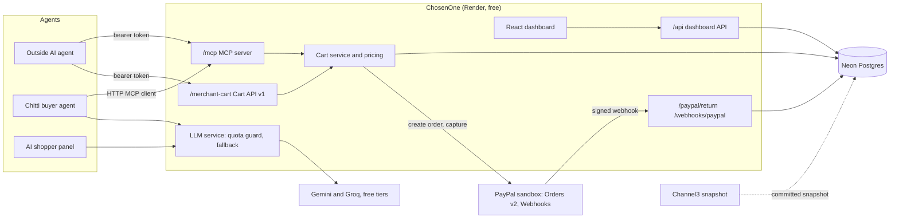
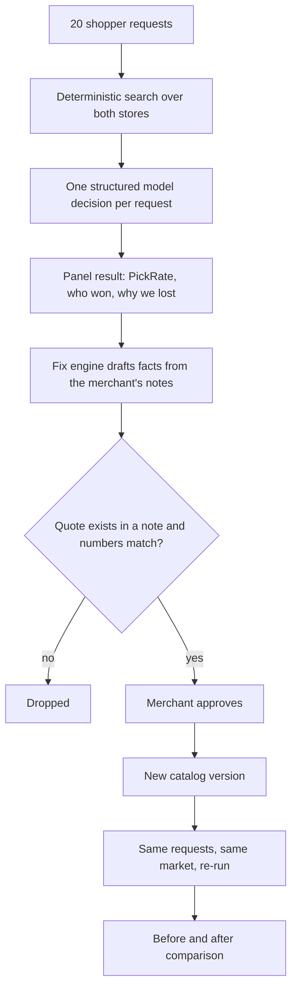

# ChosenOne: Architecture

One Node.js service (Express 5 + React) backed by Postgres. It serves the dashboard, the agent-facing
APIs and the PayPal webhook receiver on a single port.

## Components



| Part | Code | Notes |
|---|---|---|
| Agent endpoints | `server/mcp/`, `server/agent-api/` | Same bearer-token check; the calling agent is read from `X-Agent-Client` and recorded |
| Cart service | `server/commerce/` | Prices, shipping and delivery dates are computed server-side; validation issues follow the Cart API spec |
| Payments | `server/payments/` | `PaymentGateway` interface: real PayPal gateway, or an offline fake for tests and keyless runs |
| Webhooks | `server/webhooks/` | Verifies with PayPal, stores events once, updates the order ledger |
| LLM layer | `server/ai/` | Gemini and Groq through the Vercel AI SDK, per-provider quota guard, fallback to the other provider |
| Market | `server/market/` | Channel3 client, anonymiser, snapshot storage; the snapshot is committed so the demo spends no credits |
| Shopper panel | `server/panel/` | Retrieval, one structured decision per request, PickRate and reason report, comparison |
| Fix engine | `server/enrichment/` | Drafts facts, verifies quotes against the notes, publishes approved facts as a new catalog version |
| Buyer agent | `server/buyer/` | Chitti: AI SDK tool calling over an MCP client to the store's own `/mcp` |
| Recordings | `server/demo/recordings.ts`, `data/recordings/` | The real baseline and after-fix runs, seeded into every database |
| Product UI | `web/` | React 19, Tailwind 4, AG Grid Community, Lucide icons, a small hash router. A landing page, then the merchant app: Overview (setup checklist, KPIs), Where you lose (each lost sale, the shopper's reason, a suggested action), Shopper results, Fixes, Before vs after, Try as a shopper (Chitti), Connect agents |
| Demo video tooling | `video/` | Piper TTS, Playwright, ffmpeg; see [video/README.md](../video/README.md) |

## Agent checkout and attribution

```mermaid
sequenceDiagram
  participant Agent
  participant Store as ChosenOne
  participant PayPal
  participant Human as Human shopper
  Agent->>Store: search_products, get_product, get_store_policies
  Agent->>Store: create_cart (items, address)
  Store-->>Agent: cart with server-computed totals and delivery date
  Agent->>Store: checkout_cart
  Store->>PayPal: Create order (custom_id = agent=NAME;cart=ID, PayPal-Request-Id)
  PayPal-->>Store: order id and approval link
  Store-->>Agent: approval_url
  Agent->>Human: approve on PayPal
  Human->>PayPal: approve
  PayPal->>Store: redirect to /paypal/return
  Store->>PayPal: Capture order
  PayPal-->>Store: COMPLETED (or PENDING)
  PayPal->>Store: webhook PAYMENT.CAPTURE.COMPLETED
  Store->>PayPal: verify-webhook-signature
  Store->>Store: mark order webhook-confirmed
```

- The agent's name travels in the payment's `custom_id`, so every sale is attributable inside PayPal itself.
- The agent never sets a price. Totals, shipping (flat $8, free over $60), gift wrap and the delivery date come from the store's policy.
- A `PENDING` capture (for example a bank-funded sandbox payment) is shown as "clearing", not complete.

## Measure, fix, prove



- The search is identical before and after; only the catalog data changes. Each request is pinned to a preferred model so the comparison is fair.
- Panel decisions record, for every listing shown, a verdict, a reason and a reason category.
- The recorded runs are stored as data, so the hosted demo shows real results without spending model quota.

## Data model

Postgres through Drizzle (migrations in `server/db/migrations`). Neon in production, PGlite locally and in tests.

| Table | Holds |
|---|---|
| `merchants`, `catalog_versions`, `products` | The shop and every catalog version (each approved fix batch makes a new one) |
| `source_notes` | The merchant's own notes, the evidence for fixes |
| `proposals` | Drafted facts: field, value, quote, source note, status |
| `market_snapshots`, `competitor_products` | The anonymised competitor market |
| `intent_sets`, `intents` | The 20 shopper requests and their pinned model slot |
| `panels`, `runs`, `considerations` | Each panel, each request's decision, and per-listing reasons |
| `carts`, `orders` | Agent carts (Cart API body) and PayPal orders with attribution, capture id, debug ids, webhook state |
| `webhook_events` | PayPal events, keyed by event id for idempotency |
| `tool_calls` | Every MCP call with the agent, tool and a short result summary |
| `quota_usage` | Daily free-tier usage per provider and model |

## Security and abuse controls

- Sandbox only: the server refuses to start with `PAYPAL_ENV=production`.
- Secrets live in environment variables; `.env` is git-ignored and CI scans every push for secrets.
- Bearer token on the Cart API and MCP server, compared in constant time.
- Webhooks are accepted only after PayPal confirms the signature, using the exact raw request body.
- Zod validation on every input; amounts are never taken from the caller.
- Public site is `DEMO_MODE=replay`: new panels and catalog changes are refused. Chitti is limited to 8 chats per visitor per hour and 150 a day.
- Only synthetic data is sent to free-tier model providers.

## Testing and CI

Vitest with supertest. Model calls use the AI SDK's mock models, so the suite spends no free-tier quota; every database test runs on an in-memory Postgres. CI runs the secrets scan, lint, format check, type checks, tests, a production build, and a smoke test that boots the compiled server and exercises the Cart API, the panel API and the MCP endpoint.

## Free-tier stack

Render free web service (kept awake by a scheduled GitHub Actions ping), Neon free Postgres, Gemini and Groq free tiers, Channel3 free credits, GitHub Actions. Nothing is billed. See [deployment.md](deployment.md).
